# OrbitalLayout

An Auto Layout DSL for Swift. Chainable, type-safe, wraps `NSLayoutConstraint` directly.

[](https://swift.org)
[](https://developer.apple.com)
[](https://swift.org/package-manager)
[](https://cocoapods.org/pods/OrbitalLayout)
[](LICENSE)

```swift
view.orbital.add(label, [.top(16), .leading(16), .trailing(16)])
```

One call: `addSubview`, disable autoresizing mask, activate constraints.

iOS 15+ · tvOS 15+ · macOS 12+ · Swift 5.10+ · Xcode 15+

## Contents

- [Install](#install)
- [Adding subviews](#adding-subviews)
- [Constraints](#constraints)
- [Stored constraints](#stored-constraints)
- [Safe area](#safe-area)
- [Update & remake](#update--remake)
- [Activate / deactivate](#activate--deactivate)
- [Hugging & compression](#hugging--compression)
- [Debug labels](#debug-labels)
- [Sign convention](#sign-convention)
- [Multiple children](#multiple-children)
- [macOS](#macos)
- [Visual guide](#visual-guide)


## Install

**Swift Package Manager**

```swift
.package(url: "https://github.com/dimayurkovski/OrbitalLayout.git", from: "1.0.0")
```

**CocoaPods**

```ruby
pod 'OrbitalLayout'
```


## Adding subviews

```swift
// parent-side (array form — preferred)
view.orbital.add(label, [.top(16), .leading(16), .trailing(16)])

// parent-side (variadic shorthand)
view.orbital.add(label, .top(16), .leading(16), .trailing(16))

// child-side (array form — preferred)
label.orbital.add(to: view, [.top(16), .leading(16), .trailing(16)])

// child-side (variadic shorthand)
label.orbital.add(to: view, .top(16), .leading(16), .trailing(16))

// view controller — forwards to controller.view
label.orbital.add(to: controller, [.top(16), .leading(16), .trailing(16)])

// already in the hierarchy
contentView.orbital.layout(
    .top(8).to(header, .bottom),
    .leading(16), .trailing(16),
    .height(200)
)
```

`add` returns the activated constraints. The `orbit` methods do the same work without returning them, and are also available on view controllers:

```swift
view.orbit(add: label, [.top(16), .leading(16), .trailing(16)])
label.orbit(to: view, [.top(16), .leading(16), .trailing(16)])
controller.orbit(add: label, [.top(16), .leading(16), .trailing(16)])
label.orbit(to: controller, [.top(16), .leading(16), .trailing(16)])
```


## Constraints

```swift
// edges
view.orbital.layout(.edges(16))          // all 4 sides
view.orbital.layout(.horizontal(16))     // leading + trailing
view.orbital.layout(.vertical(24))       // top + bottom

// size
iconView.orbital.layout(.size(44))
bannerView.orbital.layout(.size(width: 320, height: 180))
videoView.orbital.layout(.aspectRatio(16.0 / 9.0))

// center
spinnerView.orbital.layout(.center())
badge.orbital.layout(.center(offset: CGPoint(x: 10, y: -5)))

// target another view
subtitle.orbital.layout(
    .top(8).to(titleLabel, .bottom),
    .leading.to(titleLabel, .leading)
)

// relations
descriptionLabel.orbital.layout(.height(120).orLess)
contentView.orbital.layout(.top(8).orMore.to(toolbar, .bottom))

// priority
view.orbital.layout(
    .top(16).priority(.high),
    .height(44).priority(.custom(600))
)

// multiplier
view.orbital.layout(.width.like(superview, 0.4))           // 40% of superview width
view.orbital.layout(.height.like(imageView, .width, 0.5))  // height == imageView.width × 0.5
view.orbital.layout(.height.like(.width, 1.0))             // square

// full chain → single constraint
let c = view.orbital.constraint(.top(16).to(header, .bottom).orMore.priority(.high))
c.constant = 24
```


## Stored constraints

Every constraint is stored by anchor. Named accessors return the `.equal` constraint.

```swift
view.orbital.layout(.top(16), .height(200))

view.orbital.heightConstraint?.constant = 300

// available: topConstraint, bottomConstraint, leadingConstraint, trailingConstraint,
//            widthConstraint, heightConstraint, centerXConstraint, centerYConstraint

// non-equal relations
view.orbital.constraint(for: .width, relation: .lessOrEqual)
```


## Safe area

Anchors pin to the superview by default, and the superview's edges can sit under bars. On iPhone Duo a vertical bar takes one side of the display, so pin content to the safe area on every edge, not only top and bottom.

```swift
let safeArea = view.safeAreaLayoutGuide

// groups pin every edge to the guide; insets may differ per edge
view.orbit(add: content, .edges(16).to(safeArea))
view.orbit(add: footer, .horizontal(16).to(safeArea), .bottom(16).to(safeArea, .bottom))
view.orbit(add: spinner, .center().to(safeArea))

// sizes relative to the guide
view.orbit(add: column, .width.like(safeArea, 0.5))
```

Use the superview only for full-bleed backgrounds.


## Update & remake

```swift
// update — change `constant` on existing constraints; no-op if anchor has no stored constraint
// pass the same positive inset as in layout(): the sign from creation is kept
view.orbital.update(.top(24), .height(300))
view.orbital.update(.edges(24))

// remake — deactivate and replace every constraint on the specified anchors; others untouched
view.orbital.remake(
    .top.to(navigationBar, .bottom),
    .height(120)
)

// list a minimum or maximum in the same call to keep it
bar.orbital.remake(.width.like(track, 0.5).priority(.high), .width(8).orMore)

// remove — deactivate and forget constraints; every relation unless one is given
view.orbital.remove(.top)
view.orbital.remove(.width, relation: .lessOrEqual)
```

After moving a view to another superview, call `layout()` again: `update()` cannot revive constraints to the old superview.


## Activate / deactivate

```swift
let constraints = view.orbital.layout(.top(8), .leading(16), .trailing(16))
constraints.deactivate()
constraints.activate()

// deferred activation — named accessors work even while inactive
let pending = view.orbital.prepareLayout(.top(8), .leading(16), .trailing(16))
pending.activate()
```


## Hugging & compression

```swift
titleLabel.orbital.hugging(.high, axis: .horizontal)
titleLabel.orbital.compression(.required, axis: .horizontal)
```


## Debug labels

Identifiers show up in Xcode's unsatisfiable-constraints log.

```swift
view.orbital.layout(
    .top(16).labeled("card.top"),
    .height(44).labeled("card.height")
)
```


## Sign convention

`trailing`, `bottom`, `right` — auto-negated on same-edge constraints. Always pass a positive value.

```swift
view.orbital.layout(
    .trailing(16),                                // view.trailing = superview.trailing − 16
    .bottom(16)                                   // view.bottom   = superview.bottom   − 16
)

// cross-anchor overrides
.trailing(8).to(avatar, .trailing).asOffset      // suppress negation
.bottom(16).to(header, .top).asInset             // force negation
```


## Multiple children

Every view is in the hierarchy before the closure runs, so cross-references work without ordering tricks.

```swift
let safeArea = view.safeAreaLayoutGuide

view.orbit(avatar, nameLabel, followButton) {
    avatar.orbital.layout(
        .top(24).to(safeArea, .top),
        .leading(16).to(safeArea, .leading),
        .size(80)
    )
    nameLabel.orbital.layout(
        .top.to(avatar, .top),
        .leading(12).to(avatar, .trailing),
        .trailing(16).to(safeArea, .trailing)
    )
    followButton.orbital.layout(
        .top(16).to(nameLabel, .bottom),
        .horizontal(16).to(safeArea),
        .height(44)
    )
}

// view controller — same closure form, forwards to controller.view
controller.orbit(avatar, nameLabel) {
    avatar.orbital.layout(.top(24).to(safeArea, .top), .leading(16).to(safeArea, .leading), .size(80))
    nameLabel.orbital.layout(.top.to(avatar, .top), .leading(12).to(avatar, .trailing))
}
```


## macOS

Identical API. `NSView` anchors are used automatically. `.firstBaseline` / `.lastBaseline` are UIKit-only — using them on macOS is a compile-time error.


## Visual guide

Every picture is a 200×200 superview laid out with the snippet below it, and every number is measured from the resulting frames. Pass the snippet to `view.orbit(add: child, [...])`.

Light blue is the superview, blue is the view being constrained, grey is another view it refers to.

Insets on `trailing` and `bottom` are positive and still point inward. In `.center(offset:)`, positive `y` moves down and negative `y` moves up.

### Pin to edges

<table>
<tr>
<td width="400" align="center" valign="top">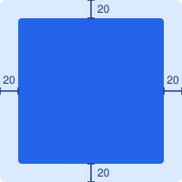<br><code>.edges(20)</code></td>
<td width="400" align="center" valign="top">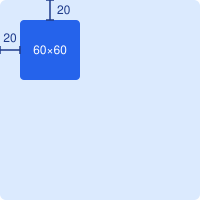<br><code>.top(20), .leading(20)</code><br><code>.size(60)</code></td>
</tr>
<tr>
<td width="400" align="center" valign="top">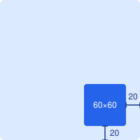<br><code>.bottom(20), .trailing(20)</code><br><code>.size(60)</code></td>
<td width="400" align="center" valign="top">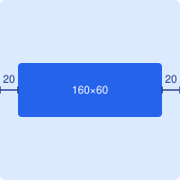<br><code>.horizontal(20)</code><br><code>.centerY(), .height(60)</code></td>
</tr>
<tr>
<td width="400" align="center" valign="top">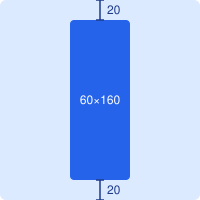<br><code>.vertical(20)</code><br><code>.centerX(), .width(60)</code></td>
<td width="400" align="center" valign="top">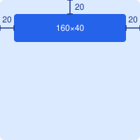<br><code>.top(20), .horizontal(20)</code><br><code>.height(40)</code></td>
</tr>
</table>

### Center

<table>
<tr>
<td width="400" align="center" valign="top">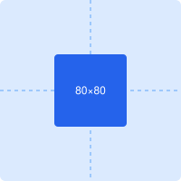<br><code>.center()</code><br><code>.size(80)</code></td>
<td width="400" align="center" valign="top">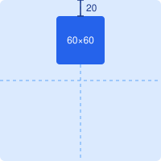<br><code>.centerX()</code><br><code>.top(20), .size(60)</code></td>
</tr>
<tr>
<td width="400" align="center" valign="top">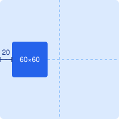<br><code>.centerY()</code><br><code>.leading(20), .size(60)</code></td>
<td width="400" align="center" valign="top">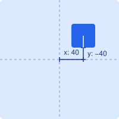<br><code>.center(offset: CGPoint(x: 40, y: -40))</code><br><code>.size(40)</code></td>
</tr>
</table>

### Size and proportions

<table>
<tr>
<td width="400" align="center" valign="top">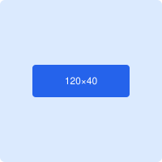<br><code>.size(width: 120, height: 40)</code><br><code>.center()</code></td>
<td width="400" align="center" valign="top">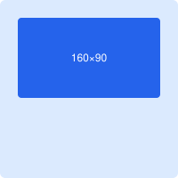<br><code>.aspectRatio(16.0 / 9.0)</code><br><code>.top(20), .horizontal(20)</code></td>
</tr>
<tr>
<td width="400" align="center" valign="top">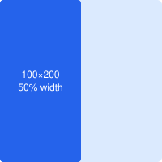<br><code>.width.like(superview, 0.5)</code><br><code>.vertical, .leading</code></td>
<td width="400" align="center" valign="top">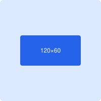<br><code>.height.like(.width, 0.5)</code><br><code>.width(120), .center()</code></td>
</tr>
</table>

### Relative to another view

<table>
<tr>
<td width="400" align="center" valign="top">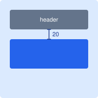<br><code>.top(20).to(header, .bottom)</code><br><code>.horizontal(20), .height(60)</code></td>
<td width="400" align="center" valign="top">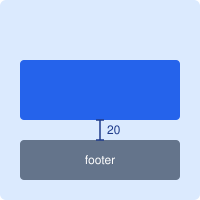<br><code>.bottom(20).to(footer, .top)</code><br><code>.horizontal(20), .height(60)</code></td>
</tr>
<tr>
<td width="400" align="center" valign="top">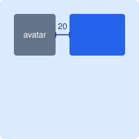<br><code>.leading(20).to(avatar, .trailing)</code><br><code>.top.to(avatar, .top)</code><br><code>.trailing(20), .height(60)</code></td>
<td width="400" align="center" valign="top">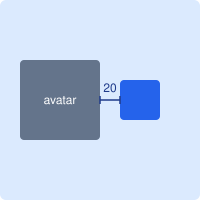<br><code>.centerY().to(avatar, .centerY)</code><br><code>.leading(20).to(avatar, .trailing)</code><br><code>.size(40)</code></td>
</tr>
<tr>
<td width="400" align="center" valign="top">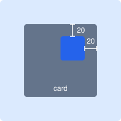<br><code>.trailing(20).to(card, .trailing)</code><br><code>.top(20).to(card, .top)</code><br><code>.size(40)</code></td>
<td width="400" align="center" valign="top">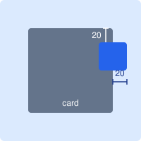<br><code>.trailing(20).to(card, .trailing).asOffset</code><br><code>.top(20).to(card, .top)</code><br><code>.size(40)</code></td>
</tr>
</table>


## License

MIT. See [LICENSE](LICENSE).
